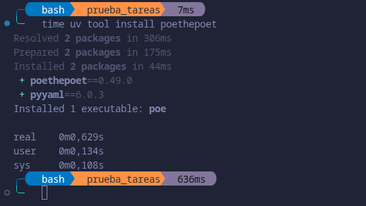
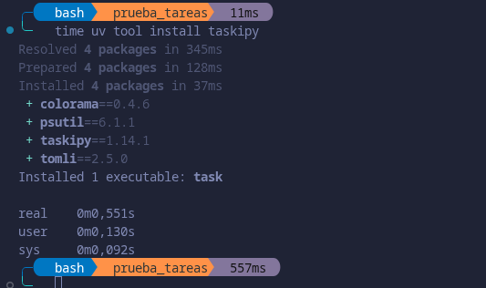
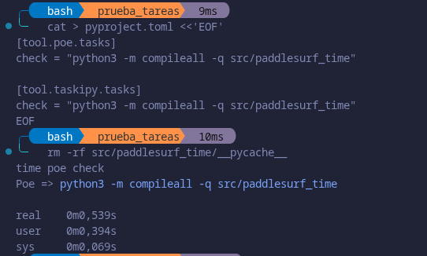
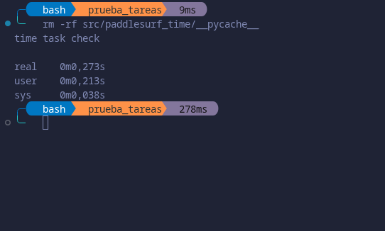

# Elección de Herramientas
 
## Gestor de dependencias
 
Antes de nada destacar que un PEP se trata de un documento de diseño que informa a la comunidad de Python o describe una nueva característica del lenguaje, de sus procesos o de su entorno. El fichero estándar para declarar las dependencias es `pyproject.toml`, ya que lo definen varios PEP, `PEP 518` crea el fichero para las dependencias necesarias para construir el proyecto. El `PEP 621` define en él la tabla `[project]`, donde van las dependencias del proyecto, y el `PEP 735` se encarga de definir `[dependency-groups]` para las dependencias que no forman parte del paquete que se distribuye. En otras asignaturas, se suele usar `requirements.txt`, pero el propio `PEP 735` indica que no está estandarizado ya que son opciones para `pip` y la documentación de `pip` dice que su formato solo está pensado para que lo lea pip. Luego solo se tienen en cuenta los gestores que trabajan con `pyproject.toml`.
 
Todos los gestores que se comparan tienen que poder hacer despliegues idempotentes, es decir, que al instalar el proyecto en cualquier máquina, y las veces que sea, quede siempre el mismo entorno con las mismas versiones de las dependencias. Esto es necesario porque el proyecto se va a instalar en workflows vacíos, y si cada instalación sacara versiones distintas, los tests podrían pasar en una y fallar en otra sin haber cambiado el código. Los cuatro gestores candidatos lo cumplen guardando la versión exacta de cada dependencia (uv en `uv.lock`, Poetry en `poetry.lock`, PDM en `pdm.lock` y Hatch en `pylock.toml`) e instalando a partir de ella, así que no sirve para elegir entre ellos. Para elegir se usan estos criterios:

- **¿Hay que instalar algo?:** si hace falta instalar algo antes de poder usarlo. En un entorno vacío, cada cosa que haya que instalar antes es tiempo que se suma y un paso más que puede fallar.
- **Tiempo de instalación de la herramienta:** lo que tarda en descargarse e instalarse el propio gestor.
- **Tiempo de instalación del proyecto:** lo que tarda en instalar el proyecto con sus dependencias.

Destacar que debajo de la tabla se incluyen unas capturas, para constrastar los datos,sobre las diversas mediciones realizadas sobre los gestores.

| Herramienta | Hay que instalar algo | Tiempo de instalación de la herramienta | Tiempo de instalación del proyecto |
|---|---|---|---|
| uv | No, es un único programa | 1,632 s | 0,035 s |
| Poetry | Sí, Python | 2,050 s | 2,021 s |
| PDM | Sí, Python | 1,471 s | 2,414 s |
| Hatch | Sí, Python | 3,027 s | 4,270 s |

Medida de uv:

Medida de Poetry:

Medida de pdm:

Medida de hatch:

Tiempo de instalación de uv:

Tiempo de instalación de Poetry:

Tiempo de instalación de PDM:

Tiempo de instalación de Hatch:

Se miden los dos tiempos porque, según indica el guion, lo que se elija ahora se va a usar en entornos donde la velocidad de instalación es esencial. En un workflow sin caché cada ejecución empieza en un entorno vacío, así que hay que instalar primero el gestor y después el proyecto, y los dos tiempos se suman.

Hatch es el que más tarda en instalarse (3,027 s) y en instalar el proyecto (4,270 s), y Poetry es el siguiente que más tarda en instalarse, así que se descartan. Entre PDM y uv, PDM se instala un poco antes, pero uv instala el proyecto mucho más rápido,sumando los dos tiempos, uv tarda 1,667 s y PDM 3,885 s. Además, PDM necesita Python para instalarse y uv es un único programa que no necesita nada. Por eso se elige uv.

## Gestor de tareas
 
Un gestor de tareas permite lanzar, como subcomandos de un solo programa, todas las tareas que hay que llevar a cabo en el proyecto definidas en un único fichero. Ahora mismo la única tarea del proyecto es comprobar la sintaxis (`check`).
Como el proyecto ya tiene el fichero `pyproject.toml`, se puede emplear un gestor de tareas que defina las tareas en ese mismo fichero, sin tener que añadir otro. make, just e invoke no lo utilizan, ya que cada uno necesita su propio fichero (`Makefile`, `justfile` y `tasks.py`), y uv necesita una aplicación externa para definir tareas, así que se plantean poethepoet y taskipy, que sí lo utilizan. Para elegir entre ellos se usan estos criterios:

- **Tiempo de instalación de la herramienta:** lo que tarda en descargarse e instalarse el gestor, ya que en un entorno vacío hay que instalarlo antes de lanzar ninguna tarea.
- **Tiempo en ejecutar `check`:** lo que tarda en lanzar la tarea de comprobar la sintaxis.

| Herramienta | Tiempo de instalación de la herramienta | Tiempo en ejecutar `check` |
|---|---|---|
| poethepoet | 0,629 s | 0,539 s |
| taskipy | 0,551 s | 0,273 s |

Tiempo de instalación de poethepoet:

Tiempo de instalación de taskipy:

Medida de poethepoet:

Medida de taskipy:

taskipy se instala antes y ejecuta `check` en la mitad de tiempo,sumando los dos, tarda 0,824 s frente a los 1,168 s de poethepoet. Por eso se elige taskipy, donde cada tarea se define en la sección `[tool.taskipy.tasks]` de `pyproject.toml` y se lanza con `task <tarea>`. La tarea `check` ejecuta `python3 -m compileall -q src/paddlesurf_time`, que compila los ficheros del modelo sin ejecutarlos, comprobando solo su sintaxis.