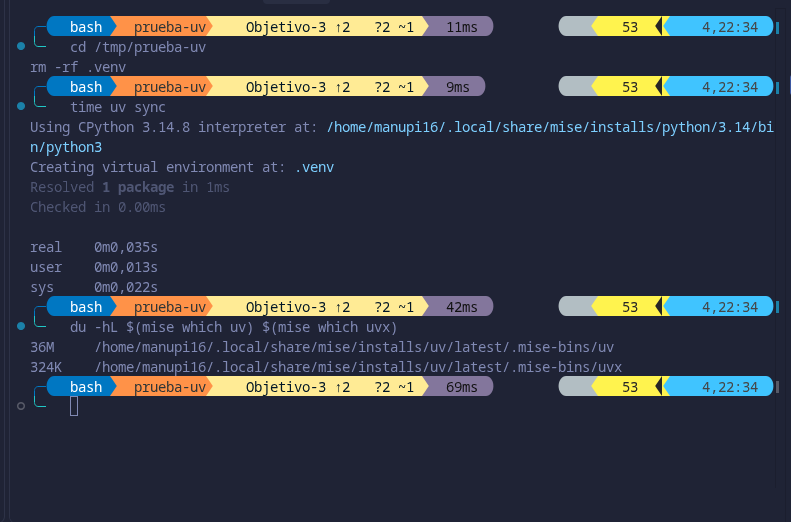
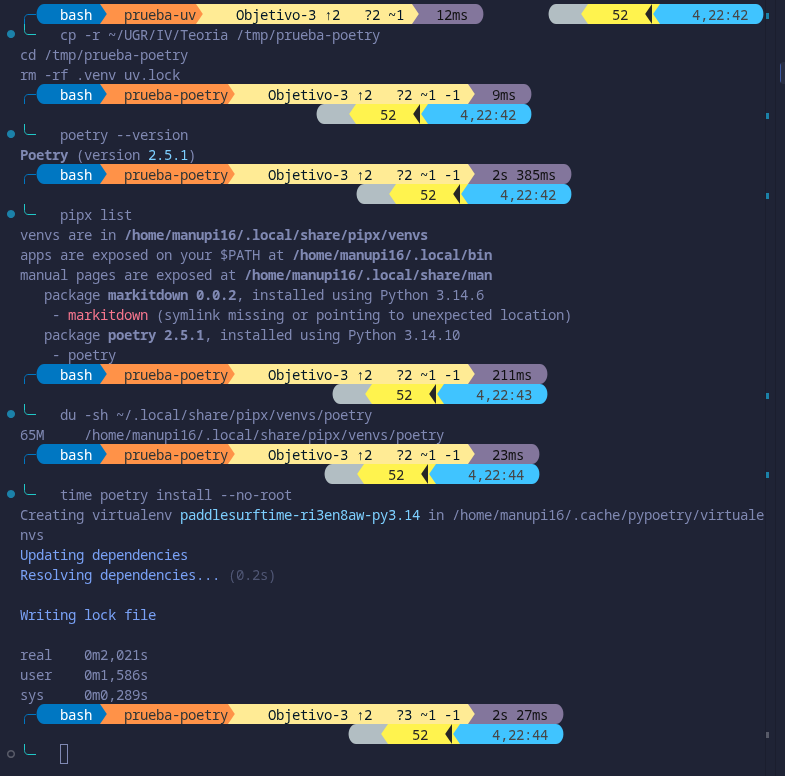
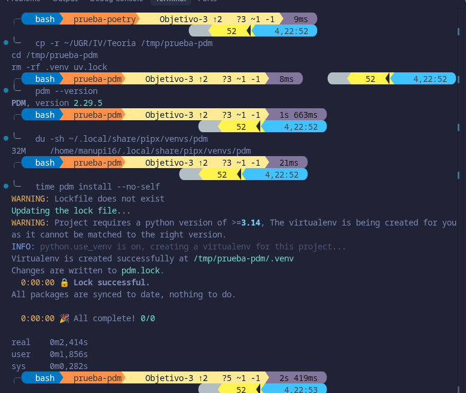
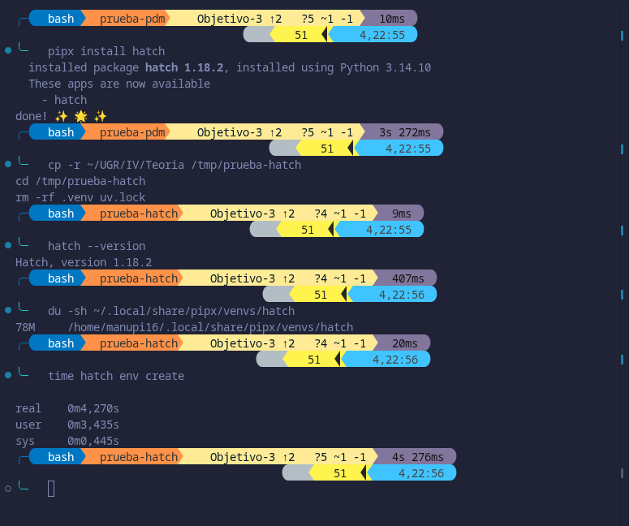
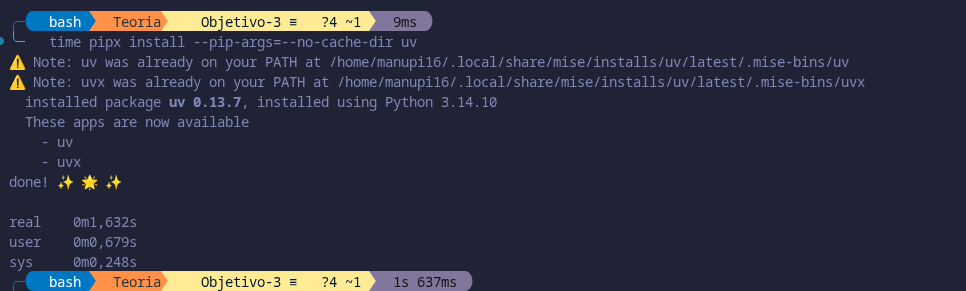
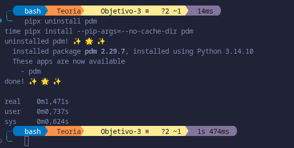
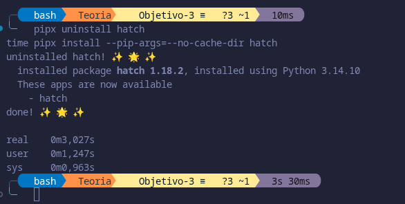
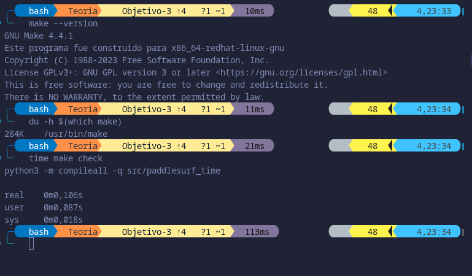
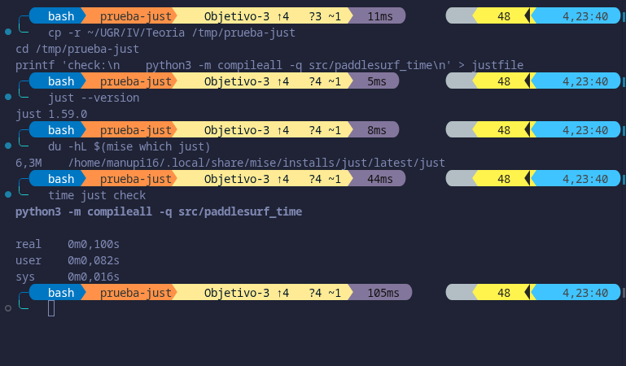
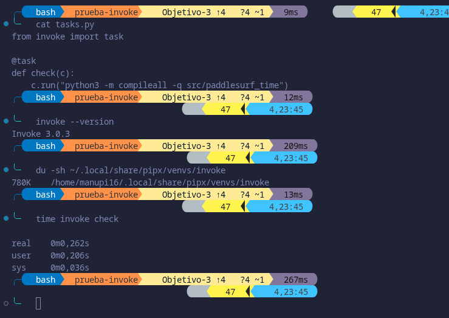

# Elección de Herramientas
 
## Gestor de dependencias
 
Antes de nada destacar que un PEP se trata de un documento de diseño que informa a la comunidad de Python o describe una nueva característica del lenguaje , de sus procesos o de su entorno. El fichero estándar para declarar las dependencias es `pyproject.toml` , ya que lo definen varios PEP, `PEP 518` crea el fichero para las dependencias necesarias para construir el proyecto. El `PEP 621` define en él la tabla `[project]`, donde van las dependencias del proyecto , y el `PEP 735` se encarga de definir `[dependency-groups]` para las dependencias que no forman parte del paquete que se distribuye. En otras asignaturas, se suele usar `requirements.txt`, pero el propio `PEP 735`indica que no está estandarizado ya que son opciones para `pip` y la documentación de `pip`dice que su formato solo está pensado para que lo lea pip. Luego solo se tienen en cuenta los gestores que trabajan con `pyproject.toml`.
 
Para comparar las distintas opciones que se han investigado, se han seguido unos criterios de la página [pydevtools](https://pydevtools.com/handbook/explanation/which-python-package-manager-should-i-use/), a saber son:

- **Lockfile:** si fija la versión exacta de cada dependencia.
- **Gestión del intérprete de Python:** si puede instalar y elegir la versión de Python que usa el proyecto.
- **¿Hay que instalar algo?:** si hace falta instalar algo antes de poder usarla
- **Espacio que ocupa:** lo que ocupa la herramienta una vez instalada.
- **Tiempo de instalación de la herramienta:** lo que tarda en instalarse el propio gestor.
- **Tiempo de instalación del proyecto:** lo que tarda en instalar el proyecto con sus dependencias.

Destacar que debajo de la tabla se incluyen unas capturas, para constrastar los datos,sobre las diversas mediciones realizadas sobre los gestores.

| Herramienta | Lockfile | Gestión del intérprete de Python | Hay que instalar algo | Espacio que ocupa | Tiempo de instalación de la herramienta | Tiempo de instalación del proyecto |
|---|---|---|---|---|---|---|
| uv | Sí | Sí | Un único programa | 36 MB (uv) + 324KB (uvx) | 1,632 s | 0,035 s |
| Poetry | Sí | Experimental | Un paquete de Python | 65 MB | 2,050 s | 2,021 s |
| PDM | Sí | Sí | Un paquete de Python | 32 MB | 1,471 s | 2,414 s |
| Hatch | No | Sí | Un paquete de Python | 78 MB | 3,027 s | 4,270 s |

Medida de uv:

Medida de Poetry:

Medida de pdm:

Medida de hatch:

Tiempo de instalación de uv:

Tiempo de instalación de Poetry:

Tiempo de instalación de PDM:

Tiempo de instalación de Hatch:

Además de los criterios de pydevtools, se han incluido el espacio que ocupa cada herramienta, lo que tarda en instalarse y lo que tarda en instalar el proyecto. Se han incluido porque según indica el guion, lo que se elija ahora se va a usar en entornos donde la velocidad de instalación y de ejecución es esencial. En un workflow la máquina empieza vacía, así que en cada ejecución hay que instalar primero el gestor y después el proyecto.

Hatch se descarta porque en la prueba no se generó ningún lockfile y además es el que más ocupa 78 MB y el que más tarda con unos 4,270 s. Por otro lado Poetry puede instalar la versión de Python que pide el proyecto, pero esa función todavía está en pruebas, además de que ocupa 65 MB.
Entre Pdm y uv, PDM es algo más liego, pero uv tarda muchísimo menos, además de que uv es un único programa, mientras que PDM es un paquete de Python que trae sus propias depdencias. Por todo lo comentado y observado en los distintos criterios se elige uv.

## Gestor de tareas
 
 Un gestor de tareas permite lanzar, como subcomandos de un solo programa, todas las tareas que hay que llevar a cabo en el proyecto definidas en un único fichero. Ahora mismo la única tarea del proyecto es comprobar la sintaxis (`check`).

Se comparan make, invoke y just. Destacar que uv no permite definir tareas, luego no sirve como gestor de tareas. Los criterios a saber son los siguientes:

- **Estilo de configuración:** declarativa (las tareas se describen en un fichero) o imperativa (se escriben como código).
- **Estándar:** si la herramienta sigue un estándar.
- **¿Hay que instalar algo?** si hace falta instalar algo antes de poder usarla.
- **Espacio que ocupa:** lo que ocupa la herramienta una vez instalada.
- **Tiempo en ejecutar check:** lo que tarda en lanzar la tarea de comprobar la sintaxis.

Al igual que para el gestor de dependencias, se adjuntan capturas mostrando las mediciones, para constrastar los datos.

| Herramienta | Estilo de configuración | Estándar | Hay que instalar algo | Espacio que ocupa | Tiempo en ejecutar `check` |
|---|---|---|---|---|---|
| make | Declarativa | Sí (POSIX) | Nada | 284 KB | 0,106 s |
| just | Declarativa | No | Un único programa | 6,3 MB | 0,100 s |
| invoke | Imperativa | No | Un paquete de Python | 780 KB | 0,262 s |

Medida de Make:

Mediciones de Just:

Mediciones de Invoke:

Se tiene observando la tabla que invoke es el único imperativo, definiendo las tareas en un archivo `.py`. Además se trata de un paquete que hay que instalar y es el que más tarda en ejecutar `check` . Por otro lado, make y just tardan prácticamente lo mismo, pero lo que sí los diferencia es que make sigue un estándar (POSIX), no hay que instalar nada y ocupa 284 KB frente a los 6,3 MB de just, lo que importa en contenedores por la misma razón que para el gestor de dependencias.

Por tanto, se elige make, donde cada objetivo del `Makefile` es una tarea que se lanza con `make<tarea>` . La tarea check ejecuta `python3 -m compileall -q src/paddlesurf_time`, que compila los ficheros del modelo sin ejecutarlos, comprobando solo su sintaxis.