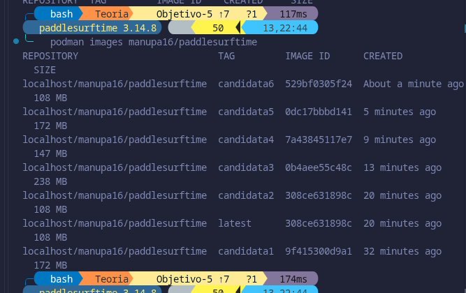
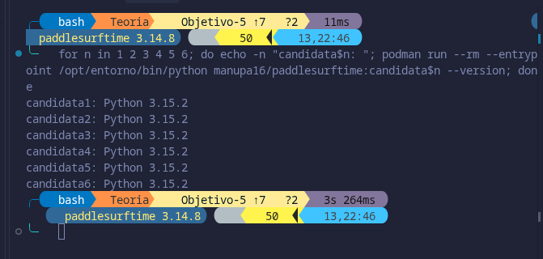
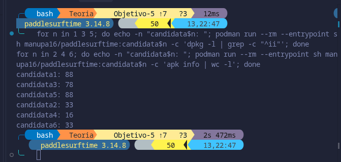

# Elección de la imagen base

## Criterios de búsqueda

Las imágenes se han buscado en Docker Hub, GitHub Container Registry y Quay. Se han buscado de tres tipos: la oficial de Python, sistemas operativos a los que se les instala Python y las que mantienen otros (buscando "python" y "uv").
Solo se consideran las que permiten usar la última versión de Python.

## Criterios de aceptación

Los criterios se han sacado de lo que pide el guion y de lo que se ha investigado en internet, la [documentación de Docker](https://docs.docker.com/build/building/best-practices/), que pide que la imagen venga de una fuente de confianza y sea pequeña, y el artículo [The best Docker base image for your Python application](https://pythonspeed.com/articles/base-image-python-docker-images/), que compara las imágenes que hay para Python.

- Trae la última versión de Python, porque la imagen es para probar el proyecto con ella.
- Viene de una fuente fiable (imagen oficial o de editor verificado) y se ha actualizado en los últimos dos meses, que es cada cuánto sale una versión de corrección de Python ([PEP 602](https://peps.python.org/pep-0602/)).
- Tamaño de la imagen, porque se descarga cada vez que se pasan los tests.
- Número de paquetes del sistema que lleva la imagen: cuantos menos, mejor, porque para pasar los tests solo hacen falta Python y uv.

## Candidatas

- `python:3.15.2-slim-trixie`: la oficial de Python sobre Debian 13, variante reducida.
- `python:3.15.2-alpine3.24`: la oficial de Python sobre Alpine.
- `debian:13-slim`: Debian sin Python, que se instala con uv.
- `alpine:3.24`: Alpine sin Python, que se instala con uv.
- `astral/uv:python3.15-trixie-slim`: la de los autores de uv sobre Debian, con Python y uv.
- `astral/uv:python3.15-alpine`: la de los autores de uv sobre Alpine, con Python y uv.

## Mediciones

Cada candidata se ha probado con un `Dockerfile` que instala uv y taskipy y lanza los tests, y en las seis pasan los 9 tests. De cada una se cuenta, en el orden de los criterios, qué versión de Python trae, de dónde viene, cuánto ocupa la imagen ya construida y cuántos paquetes del sistema lleva. Entre paréntesis está el commit donde se probó.

- `python:3.15.2-slim-trixie` ([d27ce3f](https://github.com/manupa16/PaddleSurfTime/commit/d27ce3f)): trae Python 3.15.2. Es una imagen oficial de Docker y se actualizó por última vez el 7 de noviembre de 2026. La imagen construida ocupa 172 MB y lleva 88 paquetes.
- `python:3.15.2-alpine3.24` ([f1ca726](https://github.com/manupa16/PaddleSurfTime/commit/f1ca726)): trae Python 3.15.2. Es una imagen oficial de Docker y se actualizó por última vez el 12 de noviembre de 2026. La imagen construida ocupa 108 MB y lleva 33 paquetes.
- `debian:13-slim` ([2d14f23](https://github.com/manupa16/PaddleSurfTime/commit/2d14f23)): no trae Python, así que lo descarga uv, y queda con la 3.15.2. Es una imagen oficial de Docker y se actualizó por última vez el 5 de noviembre de 2026. La imagen construida ocupa 238 MB, la que más de las seis, y lleva 78 paquetes.
- `alpine:3.24` ([c5ac04c](https://github.com/manupa16/PaddleSurfTime/commit/c5ac04c)): tampoco trae Python y lo descarga uv, con lo que queda con la 3.15.2. Es una imagen oficial de Docker y se actualizó por última vez el 8 de noviembre de 2026. La imagen construida ocupa 147 MB y lleva 16 paquetes, la que menos de las seis.
- `astral/uv:python3.15-trixie-slim` ([2309318](https://github.com/manupa16/PaddleSurfTime/commit/2309318)): trae Python 3.15.2 y uv. La publican los autores de uv, pero no es una imagen oficial ni de editor verificado. Se actualizó por última vez el 12 de noviembre de 2026. La imagen construida ocupa 172 MB y lleva 88 paquetes.
- `astral/uv:python3.15-alpine` ([04ce0f6](https://github.com/manupa16/PaddleSurfTime/commit/04ce0f6)): trae Python 3.15.2 y uv. La publican los autores de uv, pero no es una imagen oficial ni de editor verificado. Se actualizó por última vez el 12 de noviembre de 2026. La imagen construida ocupa 108 MB y lleva 33 paquetes.

En las tres de Alpine hay que instalar un compilador mientras se construye la imagen, porque `psutil`, que lo necesita taskipy, no viene compilado para Alpine. Cuando termina de instalarse, el compilador se borra.

En las capturas las imágenes aparecen como `candidata1` a `candidata6`, en el mismo orden que en la lista.

## Elección

Se elige `python:alpine`, que el 25 de noviembre de 2026 es la misma imagen que `python:3.15.2-alpine3.24` (tienen el mismo digest). Se usa la etiqueta sin versión para que la imagen pase a la siguiente versión de Python sin tener que cambiar el `Dockerfile`.

Las seis traen la última versión de Python, así que ese criterio no descarta a ninguna. Las dos de `astral/uv` quedan fuera porque no son imágenes oficiales ni de editor verificado. De las cuatro que quedan, `python:3.15.2-alpine3.24` es la que menos ocupa, 108 MB. `alpine:3.24` lleva menos paquetes, 16 frente a 33, pero ocupa 39 MB más, que hay que descargar cada vez que se pasan los tests.

