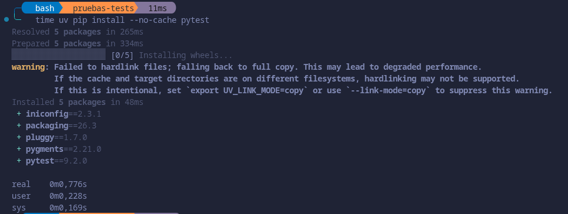
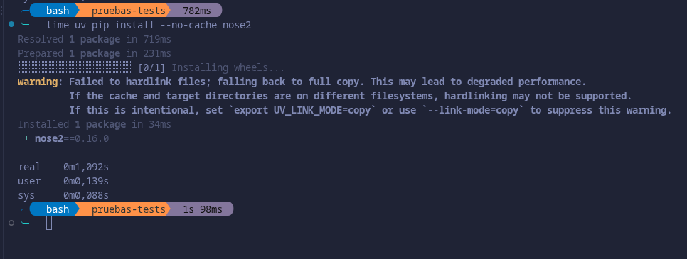
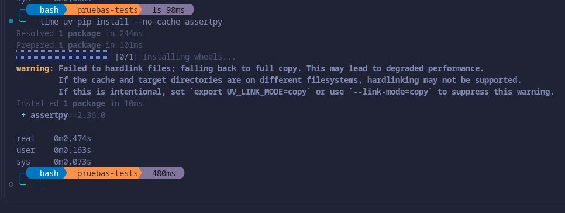
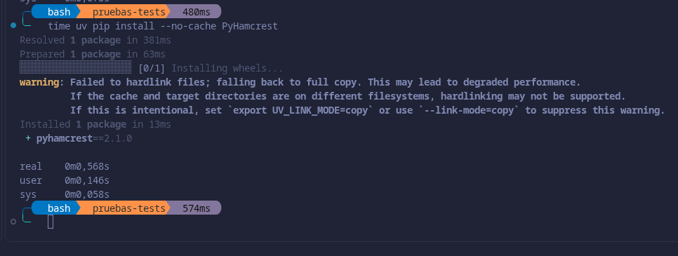
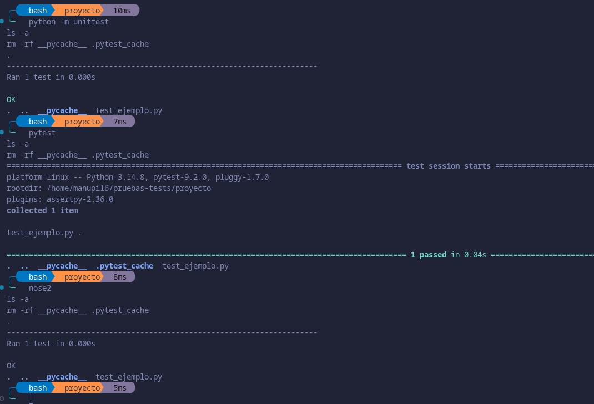
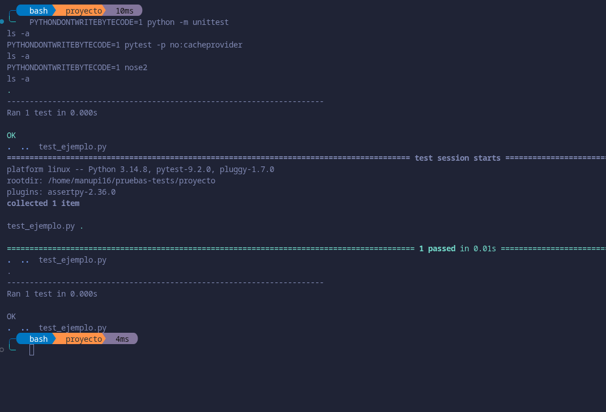

# Herramientas para los tests

## Qué hace falta

- **Biblioteca de aserciones**: es lo que comprueba que el resultado de una función es el esperado.

- **Test runner**: es el programa que busca los ficheros de test, los ejecuta y dice cuáles pasan y cuáles fallan.

## Criterios de búsqueda

Se han buscado bibliotecas de aserciones y test runners para Python en la documentación oficial de Python ([unittest](https://docs.python.org/3/library/unittest.html)), en [pydevtools](https://pydevtools.com/handbook/topics/testing/) y en [PyPI](https://pypi.org/).

## Criterios de aceptación

Biblioteca de aserciones:
1. Tiene que poder comprobar que se lanza un error, porque también hay que probar los casos en los que falla.
2. Tiempo de instalación, cuanto menos mejor, porque no se instala una sola vez, se instala cada vez que se lanza un workflow.
3. Que esté mantenida, que haya sacado alguna versión en el último año.

Test runner:
1. Que no escriba ficheros en la carpeta del código, o que se pueda configurar para que no lo haga.
2. Tiempo de instalación, cuanto menos mejor, porque no se instala una sola vez, se instala cada vez que se lanza un workflow. 
3. Que esté mantenido, que haya sacado alguna versión en el último año.

## Cómo se ha medido

Las mediciones se han hecho fuera del repositorio, en un entorno virtual nuevo con Python 3.14 creado con uv, instalando cada paquete sin usar la caché para que se descargue desde cero. Destacar que `unittest` y `assert` vienen con Python por tanto no hace falta instalarlos.

Para ver qué ficheros escribe cada runner, se ejecutó un test de ejemplo con cada uno y se hizo `ls -a` después:

Después se repitió con `PYTHONDONTWRITEBYTECODE=1`, que hace que Python no cree `__pycache__`, y con `-p no:cacheprovider` en pytest, para que no cree `.pytest_cache`. Con eso, ninguno de los tres dejó ficheros en la carpeta.

El mantenimiento se ha mirado en la última versión publicada en PyPI de cada paquete. `assert` y `unittest` no están en PyPI porque vienen con Python, así que para ellos se ha mirado la última versión de Python.
## Biblioteca de aserciones

- `assert`: por sí solo no comprueba errores y necesita `pytest.raises` o `try/except`. Viene con Python luego no se instala.Su última versión es la de Python 3.14, la 3.14.10, lanzada el 25 de octubre de 2026.
- `unittest.TestCase`: comprueba errores con `assertRaises`. Viene con Python y por tanto no se instala. Su última versión es la de Python 3.14, la 3.14.10, lanzada el 25 de octubre de 2026.
- assertpy: comprueba errores. Tarda 0,474 s en instalarse. Y su última versión es 2.36.0 lanzada el 5 de noviembre de 2026.
- PyHamcrest: comprueba errores. Tarda 0,568 s en instalarse. Y su última versiónes  2.1.0 lanzada en octubre de 2023.

`assert` no cumple el primer criterio y PyHamcrest no cumple el tercero. Entre `unittest.TestCase` y assertpy, `unittest.TestCase` no hay que instalarlo.Se elige por tanto , `unittest.TestCase`.

## Test runner

- `python -m unittest`: escribe el fichero `__pycache__`, y se evita con `python -B`. Viene con Python, por lo que no se instala. Su última versión es la de Python 3.14, la 3.14.10, lanzada el 25 de octubre de 2026.
- pytest: escribe  los ficheros `__pycache__`  y se evita con `python -B` y `-p no:cacheprovider`. Tarda 0,776 s en instalarse. Su última versión es  9.2.0  lanzada el 27 octubre de  2026.
- nose2: escribe `__pycache__`, y se evita con `python -B`. Tarda 1,092 s en instalarse. Y su última versión es 0.16.0 lanzada en marzo de 2026.

Los tres cumplen el primero y el tercero. `python -m unittest` no hay que instalarlo, así que gana en tiempo de instalación. Se elige `python -m unittest`, ejecutado con `python3 -B`, que es como se lanza en la tarea `test`.

Para comprobar que no escribían ficheros se usó `PYTHONDONTWRITEBYTECODE=1`, pero se ha investigado y la opción `-B` de Python hace lo mismo, según la [documentación de Python](https://docs.python.org/3/using/cmdline.html#cmdoption-B).

## F.I.R.S.T.

Los tests siguen los principios F.I.R.S.T. de esta forma:

- **Fast:** no usan internet ni ficheros, solo datos que se crean en el propio test, así que los 9 tests tardan muy poco.
- **Independent:** antes de cada test, `setUp` crea una `PlayasDeLaCosta` nueva, y cuando un test necesita otras condiciones hace una copia con `replace` sin tocar las de la HU001, luego ningún test depende de lo que haga otro.
- **Repeatable:** las fechas y los datos están fijos, por lo que dan el mismo resultado en cualquier máquina y en cualquier momento.
- **Self-validating:** cada test comprueba el resultado con una aserción de `unittest.TestCase` (`assertEqual`, `assertTrue`, `assertFalse` o `assertRaises`), y pasa o falla solo, sin tener que mirar nada a mano.
- **Timely:** cada test se ha escrito a la vez que su función y va en el mismo commit que la issue que resuelve.