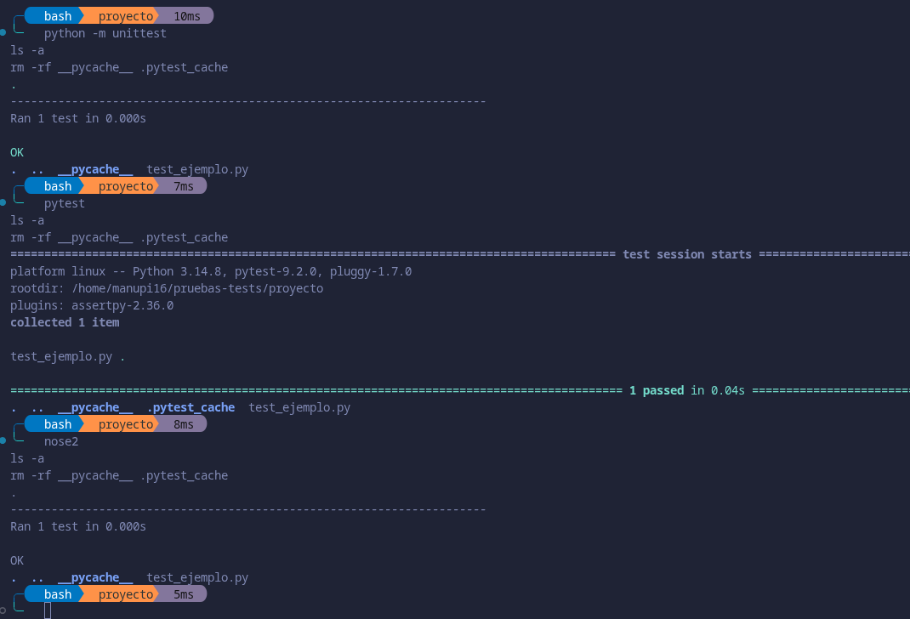
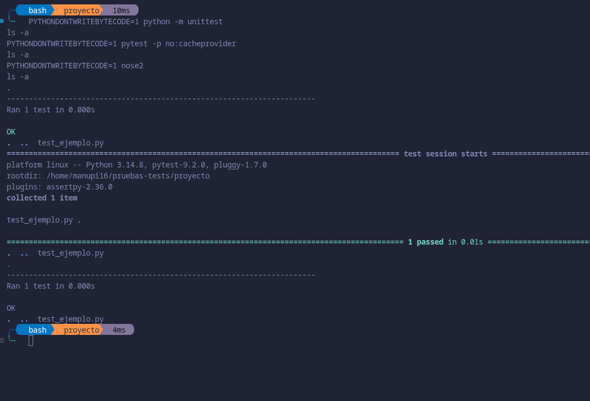
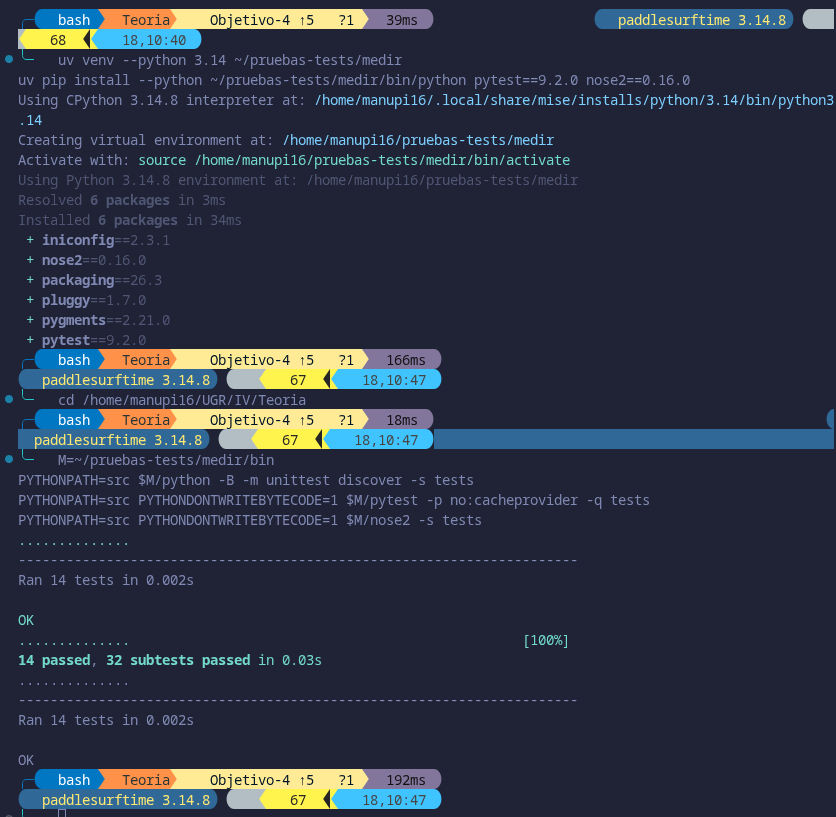
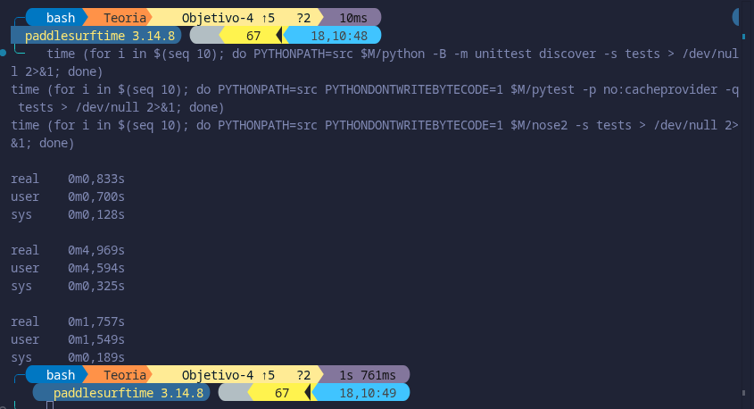

# Herramientas para los tests

## Qué hace falta

- **Biblioteca de aserciones**: es lo que comprueba que el resultado de una función es el esperado.

- **Test runner**: es la herramienta CLI que busca los ficheros de test, los ejecuta y dice cuáles pasan y cuáles fallan.

## Criterios de búsqueda

Se han buscado bibliotecas de aserciones y test runners para Python en la documentación oficial de Python ([unittest](https://docs.python.org/3/library/unittest.html)), en [pydevtools](https://pydevtools.com/handbook/topics/testing/) y en [PyPI](https://pypi.org/).

## Biblioteca de aserciones

Criterios de aceptación:
1. Tiene que poder comprobar que se lanza un error, porque también hay que probar los casos en los que falla.
2. Que esté mantenida, que haya sacado alguna versión en el último año.

El mantenimiento se ha mirado en la última versión publicada en PyPI de cada paquete. `assert` y `unittest` no están en PyPI porque vienen con Python, con cualquier versión, así que para ellos se ha investigado la última versión de Python, que es la 3.15.2. El proyecto pide Python 3.14 o superior, luego se pueden usar igual con la 3.14 que con la 3.15.

- `assert`: por sí solo no comprueba errores y necesita `pytest.raises` o `try/except`.La última versión de Python es la 3.15.2, lanzada el 25 de octubre de 2026.
- `unittest.TestCase`: comprueba errores con `assertRaises`. La última versión de Python es la 3.15.2, lanzada el 25 de octubre de 2026.
- assertpy: comprueba errores. Su última versión es 2.36.0 lanzada el 5 de noviembre de 2026.
- PyHamcrest: comprueba errores.Y su última versiónes  2.1.0 lanzada en octubre de 2023.

`assert` no cumple el primer criterio y PyHamcrest no cumple el segundo. `unittest.TestCase` y assertpy cumplen los dos, se elige `unittest.TestCase` porque es del mismo módulo que el test runner elegido, `python -m unittest`.

## Test runner

Criterios de aceptación:
1. Que no escriba ficheros en la carpeta del código, o que se pueda configurar para que no lo haga.
2. Que esté mantenido, que haya sacado alguna versión en el último año.
3. Lo que tarda en pasar los tests, cuanto menos mejor, porque se pasan cada vez que se cambia el código.

Para ver qué ficheros escribe cada runner, se ejecutó un test de ejemplo con cada uno y se hizo `ls -a` después:

Después se repitió con `PYTHONDONTWRITEBYTECODE=1`, que hace que Python no cree `__pycache__`, y con `-p no:cacheprovider` en pytest, para que no cree `.pytest_cache`. Con eso, ninguno de los tres dejó ficheros en la carpeta.

Para medir lo que tarda cada runner en pasar los tests, se instalaron pytest 9.2.0 y nose2 0.16.0 fuera del repositorio, en un entorno con Python 3.14 creado con uv, para que los tres usen el mismo Python. Primero se comprobó que los tres pasan los 14 tests del proyecto:

Después se midió con `time` lo que tarda cada uno en pasarlos 10 veces seguidas, porque una sola vez dura menos de un segundo y no se aprecia bien la diferencia:

- [`python -m unittest`](https://docs.python.org/3/library/unittest.html#command-line-interface): escribe el fichero `__pycache__`, y se evita con `python -B`. La última versión de Python es la 3.15.2, lanzada el 25 de octubre de 2026. Pasa los tests 10 veces en 0,833 s.
- pytest: escribe `__pycache__` y `.pytest_cache`, y se evita con `python -B` y `-p no:cacheprovider`. Su última versión es  9.2.0  lanzada el 27 octubre de  2026.  Pasa los tests 10 veces en 4,969 s.
- nose2: escribe `__pycache__`, y se evita con `python -B`.Su última versión es 0.16.0 lanzada en marzo de 2026. Pasa los tests 10 veces en 1,757 s.

Los tres cumplen el primero y el segundo, y `python -m unittest` es el más rápido, así que se elige `python -m unittest`, ejecutado con `python3 -B`, que es como se lanza en la tarea `test`.

Para comprobar que no escribían ficheros se usó `PYTHONDONTWRITEBYTECODE=1`, pero se ha investigado y la opción `-B` de Python hace lo mismo, según la [documentación de Python](https://docs.python.org/3/using/cmdline.html#cmdoption-B).

